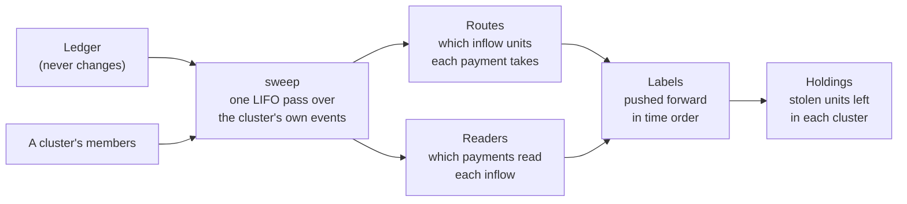

# 2. The idea: routes and labels

[← 1. The problem](01-the-problem.md) · [Index](README.md)

A LIFO trace answers two different questions at once:

1. **Routing:** *which* earlier money does each payment take? For example, "B's $70 payment takes all of the $40 B received at t4 and the top $30 of the $60 it received at t2."
2. **Labels:** *what kind* of money is that? For example, "t4's $40 was clean and t2's $60 was stolen, so the payment carries $30 stolen and $40 clean."

The whole design rests on keeping these two apart.



## Routing depends only on a cluster's members

To decide which money a payment takes, LIFO needs only the cluster's own stack heights: how much arrived, how much left, and in what order. It never needs to know whether any of it is stolen, and it never looks inside another cluster. So a cluster's routing is a function of two things: **its set of members and the fixed ledger**. That is [Theorem 4](proofs.md#factorization).

This one fact does most of the work:

- A merge or split creates a few new clusters. Only those clusters can have new routing. Every other cluster's routing is untouched, by definition.
- Routing can be cached under the member set. Undoing a merge brings back the old member sets, and their routing comes straight from the cache.
- Because routing ignores labels, a change can move routes without moving any label. That is how the engine sees "structure changed, attribution did not".

## How a stack is stored: blocks by inflow

The engine does not store individual dollars. Each cluster's stack is a list of **blocks**, one per inflow still partly on the stack, bottom first: `(inflow, units left)`. The units left are always the bottom units of that inflow, because LIFO only ever removes from the top.

In the challenge ledger, before B pays D at t5, B's stack is two blocks: `(t2, 60)` from A, then `(t4, 40)` from the clean source. The $70 payment takes the whole top block and the top 30 units of the block below. The engine records that as the payment's **route**, a short list of **pieces** `(inflow, offset, length)`, bottom first:

```
route(t5) = (t2, 30, 30), (t4, 0, 40)
```

The first piece is "30 units of t2, starting 30 units up from its bottom": the top half of t2's $60. (These docs use the challenge's times t1–t15; the code numbers transactions from 0.)

This is [`sweep`](../lifo.py#L214), one pass over the cluster's events in time order. Each event falls into one of five cases:

| Case | Code | What happens to the blocks |
| --- | --- | --- |
| Inflow | [lines 232–234](../lifo.py#L232-L234) | Push a new block `(t, amount)` |
| Internal transfer within the top block | [lines 236–237](../lifo.py#L236-L237) | Read only: one piece, nothing changes |
| Payment smaller than the top block | [lines 238–240](../lifo.py#L238-L240) | Shrink the top block; one piece |
| Payment exactly the top block | [lines 241–243](../lifo.py#L241-L243) | Remove the top block; one piece |
| Payment or internal read spanning several blocks | [lines 244–268](../lifo.py#L244-L268) | Walk down the blocks, one piece each; a payment also removes them |

A payment that spans several inflows is the normal case, not an edge case: B's t5 already does it. [Theorem 6](proofs.md#data-structures) proves the block stack always means exactly the unit stack, including both ways such a payment can end (at a block boundary, or partway into a block).

## Readers: the reverse direction

When a label changes, the engine must know which later payments read it. **Readers** answer that: `readers[s]` lists the transactions whose pieces point into inflow `s`. In the example, `t5` is the one reader of both `t2` and `t4`.

Every reader of an inflow is sent by the cluster that received it ([Theorem 7](proofs.md#data-structures)). So each cluster's sweep builds its own readers ([lines 262–273](../lifo.py#L262-L273)), and a reclustering swaps them cluster by cluster.

## Labels flow forward through the routes

A label is a run-length list of `(label, units)` pairs, bottom to top: t5's label is `(stolen, 30), (clean, 40)`. A deposit's label is its source's label. Every other transaction's label is read off its pieces, from the labels of the inflows they point into ([`_label_from_pieces`](../lifo.py#L277)). Every piece points into an *earlier* transaction, so computing labels in time order always reads finished inputs.

## Holdings need no stack at all

A cluster's stolen holdings are the stolen units pushed onto its stack minus those taken off. Add that up wallet by wallet and an internal transfer cancels: it adds to one member and subtracts from another. So the engine keeps one number per wallet, its *net stolen flow*, and a cluster's holdings are the sum over its members ([Theorem 5](proofs.md#factorization)):

```
holdings(c) = sum over wallets w in c of (stolen received by w - stolen sent by w)
```

Net flows depend only on labels, never on the clustering, so holdings move only when a label moves.

## Building the engine from scratch

[`Engine.__init__`](../lifo.py#L319) puts the pieces together:

1. Sweep every cluster once to get all routes and readers ([lines 338–342](../lifo.py#L338-L342)).
2. Compute every label, stolen count and net flow in time order ([lines 346–357](../lifo.py#L346-L357)).
3. Give each wallet its cluster and each cluster its holdings ([lines 358–362](../lifo.py#L358-L362)).

That is a full trace. Everything after this point is about *not* doing it again.

---
[← 1. The problem](01-the-problem.md) · Next: [3. The update →](03-the-update.md)
