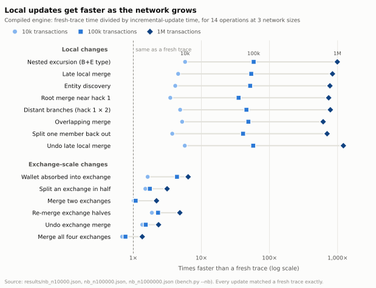

# 7. Benchmarks

[← 6. How we know it is right](06-verification.md) · [Index](README.md)

The challenge asks for networks of about 10,000, 100,000 and 1,000,000 transactions, with tracing paths of at least 20 hops, large clusters, internal transfers, and merges and splits of every kind. [`gen.py`](../gen.py) builds such networks and [`bench.py`](../bench.py) runs a fixed script of reclustering operations on them, checking every result against a fresh trace.

## The networks

[`generate`](../gen.py#L17) builds a synthetic laundering network from these ingredients:

- three hacks, each with its own stolen label, and one clean source;
- peel chains and recency-biased spending, which give deep paths (90th percentile 27 hops at 1M);
- reconvergence: stolen funds flowing back into wallets that already hold some;
- four exchanges, each with many deposit addresses (thousands at 1M) that sweep into a hot wallet (internal transfers inside one big cluster) and pay out withdrawals;
- user entities with change addresses, some of them not yet linked in the starting clustering, so a later merge "discovers" them.

| | 10k | 100k | 1M |
| --- | --- | --- | --- |
| Wallets / clusters | 4,709 / 3,838 | 47,547 / 38,621 | 481,619 / 391,861 |
| Largest cluster (addresses) | 119 | 1,194 | 11,659 |
| Internal transfers | 1,043 | 10,557 | 104,575 |
| Stolen hop depth, median / max | 11 / 28 | 17 / 52 | 16 / 53 |
| Stolen exchange deposits at 20 or more hops | 17 | 887 | 2,160 |

## The operation script

[`pick_ops`](../bench.py#L86) chooses 14 operations on the network and [`run_compiled`](../bench.py#L226) (or [`run_script`](../bench.py#L267) for the reference engine) applies them in order. After each one it times the incremental update, times a fresh trace of the new clustering, and requires the two to be identical. The operations cover local merges, a hidden change address joining its owner, merges between distant branches, an overlapping merge and its partial undo, a wallet absorbed into an exchange, splitting an exchange in half, merging exchanges, undoing earlier changes, and finally merging all four exchanges.

## What the numbers say

- **Local changes stay local.** They cost 0.2–0.4 ms at every size, so their advantage grows with the network: 6–12× faster than a fresh trace at 10k, 41–99× at 100k and 580–930× at 1M. A root merge near the hack touched 45 of 1,000,000 transactions.
- **Big clusters cost their size.** A change to one or two of the 11,000-address exchanges takes 37–110 ms at 1M, 2.0–5.6× faster than a fresh trace. A new exchange cluster costs a re-sweep of about 70,000 events per exchange. An undo whose routing comes back from the cache sweeps nothing but still relabels the tens of thousands of transactions it touches.
- **Global changes approach a fresh trace.** Merging all four exchanges re-sweeps 276,000 events and recomputes 179,000 labels: 1.3× faster at 1M. At 10k and 100k the same merge relabels more than a quarter of the network, so the linear-pass fallback takes over, and it runs at about the cost of a fresh trace (1.1× and 0.9×).

Running the same script with the routing cache off, and again with the equality cutoff off, shows what each one buys. Without the cutoff, the root merge relabels 118,101 transactions instead of 45 (54 ms instead of 0.3 ms). Without the cache, undoing the exchange merge re-sweeps 138,616 events instead of none. The [report](report.md#8-scaling-benchmarks) has the full per-operation work counts and the ablation table.

Every one of the 42 checkpoints, and the 84 in the ablation runs, matched a fresh trace exactly.

## Compile or vectorize?

[`experiments.py`](../experiments.py) measures the engine's hot paths four ways (plain Python, a pure functional fold, NumPy calls, and compiled with Numba) on the largest cluster of the 1M network. This is the evidence behind choosing Numba ([page 5](05-compiled-engine.md#why-compile-instead-of-vectorize)).

## The result files

Every number in these docs comes from a file in [`results/`](../results/). [`results/README.md`](../results/README.md) gives the command behind each log. Each benchmark JSON (for example [`nb_n1000000.json`](../results/nb_n1000000.json)) has:

- `network`: the network's statistics;
- `ops`: the 14 operations;
- `main.rows`: per operation, `inc_s` (the update's time), `fresh_s` (the fresh trace's time), the work counters (`swept`, `route_changed`, `relabeled`, `label_changed`, `cache_hits`, `linear_pass`) and `exact`;
- `mem`: memory readings. In the compiled runs these are the engine's array sizes after the build and after each operation; in the reference runs, the peak memory of each operation and each fresh trace;
- `no_cache` and `no_cutoff`: the two ablation runs.

[`docs/figures/make_figures.py`](figures/make_figures.py) draws the chart above from these files.

---
[← 6. How we know it is right](06-verification.md) · Next: [8. Running it →](08-running.md)
