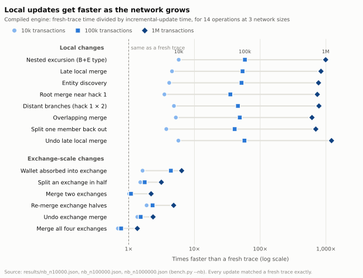

# Incremental LIFO Tracing Under Reclustering

Robert L. Jones III · November 2026

[The challenge](challenge.pdf) · [Documentation](README.md) · [Appendix: proofs](proofs.md)

**Contents.** [1. Introduction](#1-introduction) · [2. The challenge ledger](#2-the-challenge-ledger-exactly) · [3. Semantics](#3-semantics-fixed-precisely) · [4. Representation](#4-the-representation-local-routing-maps-global-label-propagation) · [5. Update](#5-the-update-algorithm) · [6. Correctness](#6-correctness-argument) · [7. Compiled engine](#7-the-compiled-engine) · [8. Benchmarks](#8-scaling-benchmarks) · [9. Limits](#9-limits-and-what-does-not-get-faster) · [10. Code](#10-code-and-reproduction) · [11. Conclusions and future work](#11-conclusions-and-future-work) · [12. References](#12-references)

## 1. Introduction

Laundered cryptocurrency is split, mixed with legitimate funds and passed through many wallets before it reaches an exchange. Tracing it needs a rule for which funds each payment carries. Heights Labs uses LIFO: an entity spends the funds it received most recently first [[4]](#12-references). FIFO [[3]](#12-references) and the poison and haircut policies [[2]](#12-references) are the common alternatives. Entities are clusters of addresses believed to share an owner, inferred with heuristics such as change-address detection [[5]](#12-references), and investigations keep revising them. When new evidence shows that two clusters are one entity, or that a cluster should be split, every attribution downstream may change.

[The Heights Labs challenge](challenge.pdf) [[1]](#12-references) asks for an algorithm that updates the trace after clusters merge or split without retracing the whole network. It must reuse what a change does not affect, and still produce exactly what a fresh trace of the new clustering would. It also asks to tell changes that move attribution apart from structural changes that leave it unchanged, and to show that the method scales to a million transactions.

This report's answer is that LIFO tracing factors into **local routing maps**, one per cluster, and a **label propagation** through them. A cluster's map says which units feed which outflow. It is the first-passage matching of that cluster's own balance path, so it ignores taint and every other cluster. A reclustering therefore changes routing only in the clusters it creates. The engine re-sweeps just those clusters' own events, or takes their routing from a cache keyed by membership. Labels are then re-propagated in time order, stopping wherever a recomputed label equals the old one. That stopping rule is also how the engine separates a change in attribution from a change in structure.

The main results:

- **The challenge ledger.** Merging B and E is detected as a no-op after re-sweeping their 5 events, and nothing downstream is touched. Merging D and F cuts Exchange X's stolen receipt from $30 to $10 and leaves $30 of stolen funds inside D+F. Reversing B–E then costs almost nothing (routing from the cache, no sweep) and changes nothing.
- **Scale.** On a 1M-transaction network with laundering paths up to 53 hops (90th percentile 27), a compiled fresh trace takes 0.24–0.31 s on a 2-core cloud machine (Section 8). The compiled engine updates local reclusterings in 0.2–0.4 ms, 610–1,200× faster. Changes to one or two 11k-address exchange clusters take 42–139 ms (2.2–6.4× faster), and merging all four exchanges takes 0.19 s, 1.4× faster than a fresh trace. An update's extra memory follows its work: none measurable for a local change, at most 35 MB for the largest, against 64 MB for a fresh trace. On the large changes the compiled engine is 4.4–7.6× faster than the pure-Python reference, whose own fresh trace takes 3.5–3.9 s.
- **Exactness.** Nine theorems, proved in the [appendix](proofs.md), show that the formulation, the data structures and the update are correct, and machine checks back every theorem. Z3 proves every path of the sweep's event code for all ids and amounts, on stacks of up to 12 blocks. A bounded exhaustive run executes both engines on every valid ledger of up to 5 transactions and 4 wallets, 268,520 ledgers and 347 million engine states each, and every state equals the unit-level specification. The compiled engine also matches the reference engine's whole state after every one of 36,190 randomized operations, and all 588 benchmark and ablation checkpoints of the two engines match a fresh trace exactly.

**The challenge's asks, one by one.** Each row is a requirement of [the challenge](challenge.pdf), in its order.

| The challenge asks for | How it is answered | Where |
| --- | --- | --- |
| Update the trace after clusters merge or split, without recomputing the entire network | One call, `regroup`, re-routes only the clusters an operation creates, from a sweep of their own events or from the cache, and re-propagates labels only as far as they change | [§5](#5-the-update-algorithm) |
| Produce exactly the results of a fresh trace under the updated clustering | Proved (Theorem 8, from an exact build) and checked against fresh traces and the unit-level specification | [§6](#6-correctness-argument), [appendix](proofs.md) |
| The exact before-and-after attribution for B–E, then D–F, then B–E reversed | Every transaction in all four states, the exchanges' stolen receipts and the clusters' holdings | [§2](#2-the-challenge-ledger-exactly), [`toy.log`](../results/toy.log) |
| All three changes in sequence, without stale cached state or double counting | Cached routing is keyed by membership and never goes stale (T4); internal transfers move nothing (T3); every undo path is checked | [§2](#2-the-challenge-ledger-exactly), [§3](#3-semantics-fixed-precisely), [§6](#6-correctness-argument) |
| An algorithm or mathematical representation that supports incremental reclustering | LIFO factors into one routing map per cluster, the first-passage matching of its balance path, and a label propagation through those maps | [§4](#4-the-representation-local-routing-maps-global-label-propagation) |
| Reuse unaffected computations | Unchanged clusters keep their routes, an undo takes routing from the cache without a sweep, and propagation stops at every unchanged label. Inside a cluster that changes, routing is recomputed; Section 11 shows how to remove that limit | [§5](#5-the-update-algorithm), [§9](#9-limits-and-what-does-not-get-faster), [§11](#11-conclusions-and-future-work) |
| Distinguish changes that affect attribution from structural changes that do not | Three levels, each detected with only the work it needs: routing-neutral (B–E: 5 events, no route changed), label-neutral (t10 under D–F), attribution change. The benchmarks count routes changed, labels checked and labels changed separately | [§2](#2-the-challenge-ledger-exactly), [§5](#5-the-update-algorithm), [§8](#8-scaling-benchmarks) |
| Networks of about 10,000, 100,000 and 1,000,000 transactions, with tracing paths of at least 20 hops | Stolen funds travel up to 28, 52 and 53 hops; 17, 887 and 2,160 stolen exchange deposits are 20 hops or more from the hack | [§8](#8-scaling-benchmarks) |
| Repeated splitting and merging of funds, clean and stolen funds mixed, large clusters, internal transfers, merges between distant branches, splits that reverse merges, successive and overlapping reclusterings | The generator builds all of them: peel chains and reconvergence, three hacks mixed with clean funds, exchanges of up to 11,659 addresses whose deposits sweep internally (104,575 internal transfers at 1M). The 14-operation script includes a distant-branch merge, undo splits and an overlapping merge | [§8](#8-scaling-benchmarks), [`gen.py`](../gen.py), [`bench.py`](../bench.py) |
| Changes that affect a small portion of the graph, and changes that alter attribution across substantial portions | At 1M, local operations touch tens of transactions; merging all four exchanges relabels 179,130 transactions and changes 63,034 labels | [§8](#8-scaling-benchmarks) |
| A working implementation | A readable reference engine and a compiled one with identical results, dependencies managed with uv | [§7](#7-the-compiled-engine), [§10](#10-code-and-reproduction) |
| A formal description of the mathematical representation | Height functions and first passage, routing maps, readers and the holdings identity, with their time and memory costs | [§3](#3-semantics-fixed-precisely), [§4](#4-the-representation-local-routing-maps-global-label-propagation), [§5](#5-the-update-algorithm) |
| A correctness argument | Nine theorems with written proofs; Z3 proofs of the sweep's code; a bounded exhaustive check of both engines, 347 million states each; randomized lockstep tests; planted-bug tests | [§6](#6-correctness-argument), [appendix](proofs.md) |
| Benchmarks comparing incremental updates against complete recomputation | Every operation timed against a fresh trace: 14 operations, 3 sizes, both engines, medians of 5 runs, plus two ablations | [§8](#8-scaling-benchmarks) |
| Measure runtime, peak memory, and the transactions or intermediate states reprocessed | Runtime and peak memory of every update and fresh trace, on a described machine; events re-swept, routes changed, transactions relabeled and labels changed for every operation | [§8](#8-scaling-benchmarks) |
| All results exactly match fresh LIFO tracing under the current clustering | Every one of the 588 benchmark checkpoints matched a fresh trace, as did every state of the checks in Section 6 | [§6](#6-correctness-argument), [§8](#8-scaling-benchmarks) |
| The central question: a structure that lets a large network be reclustered without retracing everything, with exact attribution | Yes: routing that depends on membership alone, and labels propagated through it. At 1M, local reclusterings are 610–1,200× faster than a fresh trace, and the advantage grows with the network | [§4](#4-the-representation-local-routing-maps-global-label-propagation), [§8](#8-scaling-benchmarks), [§11](#11-conclusions-and-future-work) |

**How this report is organized.** Section 2 works through the challenge ledger exactly. Sections 3 to 5 fix the semantics, the representation and the update algorithm, and Section 6 gives the correctness argument, with full proofs in the [appendix](proofs.md). Section 7 describes the compiled engine, Section 8 the scaling benchmarks, and Section 9 what does not get faster. Section 10 maps the code, Section 11 concludes and lists future work, and Section 12 gives the references. For a gentler, code-level walkthrough of the same material, start with the [documentation](README.md).

## 2. The challenge ledger, exactly

Merging B and E changes nothing. Merging D and F cuts Exchange X's stolen receipt from $30 to $10, because D's stolen $20 now stays inside D+F instead of leaving through H. Reversing B–E afterwards changes nothing further.

Each cell is the stolen dollars a transfer carries, then its composition bottom-to-top (S = stolen, C = clean). Bold marks a change from the previous column; *int* marks a transfer that is internal in that state; t7 becomes internal under D–F without changing what it carries.

| t | Transfer | $ | Baseline | +B–E | +D–F | −B–E (D–F kept) |
| --- | --- | --- | --- | --- | --- | --- |
| 1 | Stolen → A | 100 | 100 (S100) | 100 | 100 | 100 |
| 2 | A → B | 60 | 60 (S60) | 60 | 60 | 60 |
| 3 | A → C | 40 | 40 (S40) | 40 | 40 | 40 |
| 4 | Clean → B | 40 | 0 (C40) | 0 | 0 | 0 |
| 5 | B → D | 70 | 30 (S30 C40) | 30 | 30 | 30 |
| 6 | C → E | 40 | 40 (S40) | 40 | 40 | 40 |
| 7 | D → F | 50 | 10 (S10 C40) | 10 | 10 (S10 C40) *int* | 10 *int* |
| 8 | E → F | 40 | 40 (S40) | 40 | 40 | 40 |
| 9 | Clean → F | 30 | 0 (C30) | 0 | 0 | 0 |
| 10 | F → G | 80 | 40 (C10 S40 C30) | 40 | 40 (C10 S40 C30) | 40 |
| 11 | D → H | 20 | 20 (S20) | 20 | **0 (C20)** | 0 |
| 12 | G → I | 50 | 20 (S20 C30) | 20 | 20 | 20 |
| 13 | H → I | 20 | 20 (S20) | 20 | **0 (C20)** | 0 |
| 14 | I → Exchange X | 60 | 30 (S10 C30 S20) | 30 | **10 (S10 C50)** | 10 |
| 15 | G → Exchange Y | 30 | 20 (C10 S20) | 20 | 20 | 20 |

Where the $100 of stolen funds ends up:

| State | Exchange X | Exchange Y | Still held |
| --- | --- | --- | --- |
| Baseline | 30 | 20 | B 30, F 10, I 10 |
| +B–E | 30 | 20 | B+E 30, F 10, I 10 |
| +D–F | 10 | 20 | B+E 30, D+F 30, I 10 |
| −B–E, D–F kept | 10 | 20 | B 30, D+F 30, I 10 |

**Why B–E is a no-op.** E's whole life (receives $40 at t6, sends $40 at t8) happens while B sits idle on $30. In the shared stack E's $40 lands on top of B's $30 and E's outflow takes exactly it. The engine re-sweeps the 5 events of B and E together, finds every route unchanged, and so never touches anything downstream. Work: 5 events swept, 0 routes changed, 0 transactions relabeled.

**Why D–F matters.** t7 becomes internal. After t9 the D+F stack is S30 C40 S40 C30. The $80 to G pops C30, S40 and C10, the same composition as before, though the C10 now traces to t5's inflow instead of t7's (routing changed, labels did not, so propagation stops there). The $20 to H then pops clean C20 instead of stolen S20. That flips t13 and t14. Work: 6 events swept, 2 routes changed, 4 transactions relabeled, 3 actually changed. G, Y and t12 are never touched.

**Why reversing B–E is free.** Routing is a pure function of a cluster's membership, so B's and E's routing comes back from the cache without a sweep. No route differs, so nothing is relabeled.

The order of funds inside a transfer matters. If popped funds were pushed upside down, X would receive $40, $40, $60, $60 across the four states. The order-preserving rule used here is the one under which an internal transfer (pop, then push back) leaves the stack unchanged, which is what the rules require.

## 3. Semantics, fixed precisely

Every result in this report, from the toy to 1M transactions, uses one set of rules, and "exact" means tuple equality of integer outputs.

- Transactions run in index order. Amounts are positive integers (cents in practice), so no floating point is involved anywhere.
- Each cluster owns one LIFO stack of labelled funds. Sources (stolen, clean) are not clusterable; exchanges are ordinary clusters.
- A deposit from a source pushes its amount with the source's label. Several hacks can use several stolen labels.
- An external transfer pops the top *a* units of the sender's stack and pushes them onto the receiver's stack in the same bottom-to-top order.
- An internal transfer changes nothing. Its reported content is the top *a* units, which is exactly what a pop followed by an order-preserving push would move. This is why the order-preserving rule is the consistent one.
- Outputs: for every transaction, the run-length label sequence of the funds it moved, bottom-to-top, with equal neighbours coalesced; for every cluster, the stolen amount left on its stack at the end. Exchange totals and any other report are sums over these.

**Assumption: a transfer's funds keep their order.** The challenge does not say in what order a transfer's funds land on the receiver's stack, and the answer depends on it. The code assumes they keep their order. An external transfer of *a* units takes the top *a* units of the sender's stack and places them on the receiver's stack in the same bottom-to-top order, so the unit that was on top at the sender is on top at the receiver. An internal transfer moves nothing; it only reports the top *a* units. Every implementation encodes this the same way:

- the unit-level specification, [`spec_trace`](../verify/exhaustive.py#L151), gives unit *x* of a transfer the label of the *x*-th unit it carried, bottom first, and an internal transfer pushes nothing ([lines 173–187](../verify/exhaustive.py#L173-L187));
- the reference tracer, [`fresh_trace`](../lifo.py#L149), pushes the carried runs bottom first ([line 200](../lifo.py#L200)), and the compiled tracer, [`_fresh`](../lifo_nb.py#L661), does the same ([line 719](../lifo_nb.py#L719));
- the engine's [`sweep`](../lifo.py#L214) pushes an inflow as one block whose offsets 0 … *a* − 1 follow its route's pieces bottom first ([lines 232–234](../lifo.py#L232-L234)), so its label is its pieces' labels in order;
- an internal transfer reads the top of the stack without popping it, in the tracer ([lines 176–186](../lifo.py#L176-L186)) and in the sweep ([lines 236–237](../lifo.py#L236-L237)).

Keeping the order is the only choice consistent with the challenge's rule that internal transfers preserve funds. Seen as "pop, then push back", an internal transfer leaves every stack's labels unchanged only if the order is kept ([Theorem 3](proofs.md#the-formulation), checked by Z3 for every permutation of up to 5 units). For external transfers it remains a modelling choice. Reversing the order, which `fresh_trace(..., order="reverse")` implements and [`toy.py`](../toy.py#L90) prints for comparison, sends $40, $40, $60 and $60 of stolen funds to Exchange X across the four states instead of $30, $30, $10 and $10.

## 4. The representation: local routing maps, global label propagation

LIFO tracing factors into two parts. Which units feed which outflow is decided inside each cluster from that cluster's own events alone. Which units are stolen is then propagated through those decisions. Reclustering only ever disturbs the first part, and only for the clusters that changed.

**Positions.** Give every transaction *t* of amount *a*ₜ the unit positions 0 … *a*ₜ − 1, bottom to top. A trace assigns a label to every position.

**Height function.** For a cluster *c*, let δ(*e*) be +*a* for an inflow event, −*a* for an outflow and 0 for an internal transfer. The cluster's stack height (its balance) after event τ is

```math
H_c(\tau) = \sum_{e \le \tau} \delta_c(e)
```

A unit sits at a fixed height while it stays on a stack, because a stack only changes above it. So a unit deposited by inflow *s* at height *y* is consumed by the first later event that takes the stack down to *y* or below:

```math
\kappa_c(s, y) = \min \{\, \tau > s \;:\; H_c(\tau) \le y \,\}
```

This is first passage below a level: the bracket matching of the up-steps and down-steps of the path *H* of the cluster, the same structure as matching parentheses in a Dyck path [[6]](#12-references) (see the note at the end of this section). It depends on amounts and order only, never on labels.

**Routing map.** For each outflow or internal read *t* of *c*, LIFO therefore defines a map ρ*c* from *t*'s positions to positions of earlier inflows of *c*. It is a piecewise translation: a short list of pieces (inflow *s*, offset, length), each copied in order. The trace is the propagation of source labels through these maps, in time order:

```math
\ell_t(x) = \ell_s(x') \quad \text{where } (s, x') = \rho_c(t, x), \qquad \ell_t \equiv \text{label of the source if } t \text{ is a deposit}
```

**Three consequences.**

1. *Locality.* ρ*c* is a function of *c*'s membership and the immutable ledger. A merge or split recomputes ρ only for the clusters it creates: the one merged cluster, or both halves of a split. Every other routing map is untouched by definition.
2. *Memoization.* Because ρ*c* depends on membership alone, it can be cached under that membership set and stays valid for as long as it is kept. Undoing a merge restores the old maps instead of recomputing them.
3. *Taint-blindness.* Routing never looks at labels, so a reclustering's structural effect (which routes moved) is separable from its attribution effect (which labels moved). A route can move without any label moving, as t10 does in the toy.

**Withdrawals that span several inflows.** An outflow larger than the newest inflow on the stack takes all of it and continues into older ones. The challenge ledger does this from the start. In the baseline clustering B holds $60 stolen (t2) under $40 clean (t4), so its $70 payment to D (t5) takes the $40 clean and then $30 of the $60 stolen. That split is why D receives $30 stolen and $40 clean. F's $80 payment (t10) takes its two newest inflows whole and $10 of a third, and I's $60 payment (t14) reaches into a second. Such a withdrawal ends in one of two ways: exactly at the boundary of an inflow, which is then used up, or partway into one, which stays on the stack with its remaining units. Any exact LIFO trace, fresh or incremental, has to handle both.

**How a stack is stored.** The challenge leaves open how a stack is recorded, and every option has to do the same splitting:

| Stored as | B's stack before t5 | Used by | Trade-off |
| --- | --- | --- | --- |
| Individual units | 100 one-dollar entries | The specification | Work grows with the amounts, which is hopeless for real ledgers (a bitcoin is 10⁸ satoshis) |
| Label runs | ($60 stolen, $40 clean) | The reference tracer | Enough for a one-shot trace, but it forgets which inflow each run came from, so nothing can be reused after a reclustering |
| Blocks by inflow | (t2, 60), (t4, 40) | The engine | A withdrawal records which units of which inflows it took, with no labels, so that record depends on membership alone |

The multi-inflow withdrawal is required by the problem. Keying the blocks by inflow is required by the incremental design: the pieces of the routing map are exactly what a withdrawal takes from each block, and the routing cache, the readers index and propagation with the cutoff all rest on them. [Theorem 6](proofs.md#data-structures) proves that the block stack represents the unit stack exactly, including both ways a multi-inflow withdrawal ends.

**Readers.** The inverse of routing, written readers(*s*), lists the transactions whose pieces point into inflow *s*. When a label changes, this list says exactly which transactions to recheck. Every reader of *s* is sent by the cluster that received *s*. Each cluster's sweep therefore builds its own readers, and a reclustering replaces them cluster by cluster, never entry by entry.

**Holdings.** A cluster's stolen holdings are the stolen units pushed onto its stack minus those popped off. Summed wallet by wallet, an internal transfer adds to one member and subtracts from another, so it cancels. Writing σ(*t*) for the stolen units transaction *t* carries:

```math
\mathrm{hold}(c) = \sum_{w \in c} \Big( \sum_{t:\, \mathrm{dst}(t) = w} \sigma(t) \; - \sum_{t:\, \mathrm{src}(t) = w} \sigma(t) \Big)
```

The inner sums depend on the clustering only through the labels. Holdings therefore need no stack at all, and they move only when a label moves.

**Sizes.** Write *n* for the transactions, *P* = Σₜ |route(*t*)| for the pieces in all routes, and *R* = Σₜ |*L*ₜ| for the runs in all labels. The engine's state is linear in these:

| Structure | Holds | Memory |
| --- | --- | --- |
| Routes ρ | the pieces of every outflow and internal read | O(*P*) |
| Readers | the inverse of the routes, one entry per piece | O(*P*) |
| Labels | the runs of every transaction | O(*R*) |
| Stolen counts, net flows, owners | one number per transaction or wallet | O(*n*) |
| Routing cache | at most *n* routes, with their readers | O(*P*) |

Sweeping a cluster with *e* events and *P*\_c pieces costs O(*e* log *e* + *P*\_c), to merge its wallets' event lists and emit the pieces, and a fresh trace costs Θ(*n* + *R*), because each transaction pops, reads or pushes exactly the runs of its own label. Neither *P* nor *R* is bounded by *n* in general, but on the benchmark networks both stay within 1.3*n* (Section 8).

> **Note on Dyck paths.** Strictly speaking, a Dyck path starts and ends at zero and never goes below it; the paths with n up-steps are counted by the Catalan number Cₙ. A cluster's balance path starts at zero and never goes below it, because a cluster cannot overdraw, but it usually ends above zero. It is therefore a Dyck prefix, also called a ballot path. The matching rule is the same: each up-step is matched by the first later down-step back to its level. The up-steps still unmatched at the end are exactly the funds left on the cluster's final stack. Each transaction is also a run of *a*ₜ identical unit steps rather than a single step, which is why each routing map comes out as a few contiguous pieces.

## 5. The update algorithm

Every reclustering is one call, [`regroup(blocks)`](../lifo.py#L396). A block that is already a cluster is dropped first, since it changes nothing; the clusters the remaining blocks touch are replaced by those blocks plus whatever is left of each. Merge and split are its two common cases, and any overlapping change is a single call too. It runs in four steps.

1. *Route the new clusters.* Take each new cluster's routing and readers from the cache, keyed by membership, or compute them with one LIFO sweep over that cluster's own events. The cache is LRU and holds at most n routes.
2. *Find the changed routes.* Only transactions sent by members of the replaced clusters can change route, the given wallets and the remainders they leave alike, and each whose new pieces differ from its old ones becomes a seed. The new clusters' readers replace the old clusters' readers wholesale.
3. *Propagate labels.* Pop seeds from a min-heap in time order and recompute each label from its pieces. If it equals the old label, stop there. Otherwise move holdings by the change in stolen units and enqueue the transaction's readers. Every input precedes its reader, so each label is computed from final inputs.
4. *Fall back to a linear pass.* If the wave passes n/4 recomputed transactions, finish with one linear pass over every later transaction. That caps the number of recomputations at about 1.25n (Theorem 9), though not their cost (see Cost below).

**Three levels of "does this change matter".** Each level is detected with only the work it needs, never by retracing downstream.

| Level | What happens | Work done | Toy example |
| --- | --- | --- | --- |
| Routing-neutral | Re-sweeping reproduces every old route | The changed clusters' events only | B+E: 5 events, 0 routes |
| Label-neutral | Routes move, but the moved funds carry the same labels | Plus one relabel per moved route | t10 under D+F |
| Attribution change | Labels change and propagate until outputs stop changing | Plus the changed transactions and their direct readers | t11 → t13 → t14 under D+F |

**Cost.** For one regroup, let *M* be the members and *e* the events of the clusters it replaces (the new clusters have the same ones), *P*\_old and *P*\_new the pieces of their routes before and after, *Q* the transactions it recomputes, *q* the largest heap, and *r*(*t*) the readers of *t*. Recomputing one label from its pieces costs *c*(*t*) = Σ over the pieces (*s*, *o*, ℓ) of 1 + |*L*ₛ|, the walk to each piece's offset in its input's runs. [Theorem 9](proofs.md#the-algorithm) gives:

| Step | Time | Extra memory |
| --- | --- | --- |
| Form the new clusters | O(\|*M*\|) | O(\|*M*\|) |
| Store each outgoing cluster's routing for a later undo, unless cached | O(*e*), or O(*e* + *P*\_old) compiled | the same |
| Route the new clusters | sweep: O(*e* log *e* + *P*\_old + *P*\_new); cache hit: O(*P*\_old + *P*\_new) | O(*e* + *P*\_new) |
| Propagate labels | O(Σ\_{*t*∈*Q*} (*c*(*t*) + *r*(*t*) log *q*)) | O(*q*) |
| Fresh trace, for comparison | Θ(*n* + *R*) | Θ(*n* + *R*) |

Every term counts only what the regroup touches: the replaced clusters' events and pieces, and the transactions whose labels it has to check. On the benchmark networks routes and labels are short, about 1.3 pieces and 1.1–1.2 runs per transaction, so a local change costs tens of events and at most about 150 labels, whatever the size of the network.

**The worst case.** The linear pass bounds the number of recomputations, not their cost against a fresh trace. With it, a regroup costs at most O(*n* log *n* + *P* + *C*) time, where *C* = Σₜ *c*(*t*), and O(*n* + *P*) extra memory. A fresh trace works on runs and an update on pieces, and a ledger can have far more pieces than runs. *K* one-unit deposits into a wallet A, followed by *K* transfers of the whole balance back and forth between A and B, give *P* = *K*² once A and B are merged: each transfer becomes an internal read of all *K* deposits. Every label is still a single run, so *R* = 2*K*. [`experiments.py`](../experiments.py) measures that merge at 40–673 times the time of a fresh trace, depending on *K* and the engine. On the benchmark networks, where *P* and *R* stay within 1.3*n*, the slowest update with the default settings, merging all four exchanges at 10k in the compiled engine, took 1.5 times a fresh trace (Section 9).

This is the pattern of self-adjusting computation, memoization combined with change propagation [[7]](#12-references), with the early cutoff of build systems [[8]](#12-references): a recomputed value equal to the old one stops the propagation.

## 6. Correctness argument

After every operation the engine holds exactly what a from-scratch build of the current clustering would: routing, readers, labels, per-wallet net flows and holdings. The [appendix](proofs.md) proves this in nine theorems with textual proofs, each backed by machine checks, in three layers: the formulation is well defined and conserves funds (T1–T3); routing and holdings factor by cluster, and the data structures represent what they claim (T4–T7); every regroup preserves exactness and terminates (T8–T9). In brief:

1. **Routing is exact.** Which units each of a cluster's transactions carries depends only on the cluster's membership and the immutable ledger (T4), and the run-length sweep computes it exactly (T6). A new cluster's routing comes from a sweep or from a cache entry for the same membership. Clusters an operation does not touch keep theirs.
2. **Readers are exact.** Every reader of an inflow is sent by the cluster that received it (T7). Replacing the readers of the changed clusters' inflows, keyed by receiver, therefore rebuilds exactly the entries that can change.
3. **Labels are exact.** A label is a function of its route and its inputs' labels (the label lemma), so a stored label can be wrong only if its route changed or an input's label changed. Every changed route is a seed, and every changed label enqueues its readers. Inputs precede readers, so transactions leave the heap in increasing time and each is recomputed from final inputs. By strong induction on time, every transaction before the linear pass whose label changes is reached, and one never reached still holds a correct label. The cutoff is sound because an unchanged label changes no reader's inputs. If the linear pass starts, it starts at the smallest pending transaction: everything before it is final, and the pass recomputes everything after it in order (T8).
4. **Holdings are exact.** Holdings are sums of per-wallet net flows (T5), which depend on labels alone. A new cluster sums its members' flows when it is installed, before propagation starts. Each changed label then moves its sender's and receiver's flows, and their clusters' holdings, by its change in stolen units.

Building the engine gives an exact state to start from (the build lemma), so by induction the state is exact after every operation. Every output is a function of labels and holdings, so outputs equal a fresh trace. Integer arithmetic makes the equality literal.

**Evidence.**

| Check | Scale | Result |
| --- | --- | --- |
| Challenge ledger: compiled engine, reference engine, reference tracer and unit-by-unit tracer in every state ([toy.py](../toy.py)), and a separate implementation written from the rules alone ([verify/toy\_independent.py](../verify/toy_independent.py)) | 15 tx, 3 events | Identical |
| Z3 proofs ([verify/smt\_checks.py](../verify/smt_checks.py)) on a transcription of lifo.sweep: every feasible path of its event code with symbolic ids, block sizes and amounts; push order. Fidelity: the transcription computes the same routes as the reference sweep and both compiled code paths | 313 paths, stacks of up to 12 blocks; 153 permutations; 127,399 routes | All proved; 9 injected bugs refuted; routes identical |
| Bounded exhaustive check of each engine against the unit-level specification ([verify/exhaustive.py](../verify/exhaustive.py)): every valid ledger in scope, every clustering, every single-block regroup with undo, every merge and split with undo, and every ordered pair of clusterings; full state compared after each operation; the engine's self-check, and the compiled engine's hidden state, after every 16th operation and at the end of each run | 268,520 ledgers of up to 5 tx and 4 wallets, amounts 1–2, one stolen and one clean source; 1,944,228 (ledger, clustering) cases; 347,056,276 engine states per engine; 5 engine settings | All identical, both engines |
| Random merges, splits and regroups on the reference engine. After every operation, compared with a fresh trace and with a from-scratch rebuild (routing, readers, per-wallet flows); readers also checked as the exact inverse of routing | 6,000 ledgers, 36,190 operations, 5 engine settings | All identical |
| The compiled engine in lockstep with the reference: whole state compared after every operation, routing cache, cluster order and work counters included, and the compiled engine's hidden state checked (live-row counters, arena bounds, scratch arrays, cluster ids); both compared with fresh traces and rebuilds | 6,000 ledgers, 36,190 operations, 5 engine settings × 3 compaction slacks, 20,603 arena compactions | All identical |
| Targeted tests: amounts just below the compiled engine's 64-bit bound and labels near 2⁶³; amounts around 10³⁰ on the reference; ledgers past the bound, refused by the compiled engine and run on the reference; every kind of linear-pass threshold, also changed between operations; a compaction slack lowered between operations; the holdings array growing past its initial size | 1,642 operations on the reference, 1,668 in lockstep | All identical |
| The self-checks themselves: a label (either column of a run) or a holding corrupted on purpose | Both engines | Every corruption detected |
| The compiled engine with array bounds checks compiled in, in lockstep with the reference | 1,000 ledgers, 6,126 operations, plus the targeted tests | No out-of-bounds access; all identical |
| The reference tracer itself against an independent unit-by-unit tracer | 21,734 operations on the random suite's small-amount ledgers | Identical |
| Invalid input: overlapping sets, source or unknown wallets, negative or non-integer wallet ids, amounts and labels (floats, bools), overdrafts, a split across clusters, a non-numeric threshold | Validation suite, both engines | Rejected with the same error by both, nothing changed |
| Mutation tests ([mutate.py](../mutate.py) --exhaustive): 12 bugs injected into the reference engine and 22 into the compiled one, in readers, holdings, flows, the sweep, the one-pass build, propagation, the fallback, the regroup bookkeeping, compaction and its counters, the compiled fresh trace, the cluster order and the self-checks | Random suite; the exhaustive run's quick scopes | Random suite: all 34 caught. Exhaustive: 30 of the 31 it runs; the other needs more than 16 cluster ids, beyond its scope. The 3 self-check bugs are left to the negative tests |
| Every benchmark checkpoint compared with a fresh trace | 14 operations × 3 sizes, both engines, plus both ablations | All identical |

The random suite's five settings are the defaults, an aggressive linear-pass threshold, a tiny cache, no cache and no cutoff, and for the compiled engine they are crossed with a compaction slack of 4,096 (the default), 0 and 64. The exhaustive run's are the defaults, heap-only propagation with and without the cutoff, and an immediate linear pass with no cache or a one-route cache. Each mechanism is therefore also tested on its own.

The Z3 proofs execute the sweep's code symbolically, path by path [[10]](#12-references), and discharge each path with the Z3 SMT solver [[9]](#12-references). The bounded exhaustive check rests on the small-scope hypothesis, that most bugs already show up in small cases [[11]](#12-references). The lockstep suite is differential testing [[12]](#12-references), and the planted bugs are mutation testing [[13]](#12-references): a bug the tests would miss shows that the tests are too weak.

## 7. The compiled engine

The algorithm is implemented twice, with one interface and identical results. [`lifo.py`](../lifo.py) is a direct, readable rendering in standard-library Python: the reference, and the fallback when NumPy and Numba are not installed. [`lifo_nb.py`](../lifo_nb.py) is the engine to use: the same algorithm compiled to machine code with Numba [[14]](#12-references). [`engine.py`](../engine.py) picks the compiled engine when it can. The pure-Python version as it stood before the compiled engine was added is tagged `python-baseline` in the package's git history.

**Why compile rather than vectorize.** The loops that carry the work are sequential. A cluster's sweep reads the stack the previous event left. A label is computed from the labels of earlier inflows. Propagation pops from a heap whose next entry depends on which labels just changed. NumPy [[15]](#12-references) speeds up operations over whole arrays, not loops like these, and on the engine's small objects it is slower: a label recomputation, typically 1.4 pieces, costs 0.89 µs with Python tuples and 21 µs through NumPy calls, 24× more. NumPy does help where the work is a bulk array operation: building a large cluster's event list (1.4× faster, or 5.6× by masking the whole ledger) and summing net flows at build time (3.3×). Writing the sweep as a pure functional fold over an immutable stack takes 1.10× the plain loop's time: in Python, style barely changes the cost. Numba instead translates ordinary loops over NumPy arrays into machine code through LLVM. On the busiest 1M cluster, 69,805 events over 11,498 addresses, the compiled sweep, event list and readers included, ran 14× faster than the plain Python one, with identical routes and readers. These measurements are [`experiments.py`](../experiments.py), and its output is [`results/experiments.log`](../results/experiments.log).

**How the state is stored.** Compiled code works on flat arrays of integers, not on Python tuples, dictionaries and objects, so the compiled engine keeps every per-transaction structure in NumPy arrays and leaves only per-cluster bookkeeping in Python:

| Structure | Reference engine | Compiled engine |
| --- | --- | --- |
| Routing of each transaction | a tuple of pieces (inflow, offset, length) | rows of a pieces arena, located by a start and a count per transaction |
| Labels | a tuple of runs (label, units) | rows of a runs arena, located the same way |
| Readers | a dictionary from inflow to a list of transactions | rows of a readers arena, located the same way |
| Stolen counts and net flows | integer arrays | integer arrays |
| Clusters | objects holding members and holdings | a cluster id per wallet and a holdings array, with member sets kept in Python |
| Routing cache | routings and readers by membership, in LRU order | the same, held as arrays |

For example, in the challenge ledger B's $70 payment (t5) has its route in rows 2–3 of the pieces arena, (t2, 30, 30) and (t4, 0, 40), and its label in rows 4–5 of the runs arena, (stolen, 30) and (clean, 40). Its stolen count is 30, and t5 is the one reader of both t2 and t4.

The arenas are append-only. When an update changes a route or a label, it writes the new rows at the end and repoints the transaction; the old rows become dead. Once dead rows outnumber live ones by more than a slack of 4,096 rows, a compaction copies the live rows into a fresh arena. The kernels write rows into existing arrays; the Python side allocates only the bookkeeping for the clusters an operation replaces: their member sets, small index arrays and cache entries. Each arena gets a quarter of headroom at build, so early updates do not trigger a copy.

**What runs compiled, and what stays in Python.** The work runs in compiled kernels, 21 compiled functions in all counting helpers such as array growth and the heap. The main ones are:

- the sweep, with exactly the branches of the reference's sweep;
- the build, which computes every cluster's routing in one pass over the ledger, keeping each cluster's blocks in a linked list (equal to sweeping the clusters one by one, by [Theorem 4](proofs.md#factorization));
- the snapshot of an outgoing cluster for the cache;
- the installation of a new cluster's routes, which finds the changed ones;
- label recomputation and the propagation heap, with the cutoff and the linear-pass fallback;
- the readers index, grouped by counting;
- a large cluster's event list, built by marking its events and scanning once;
- compaction;
- the fresh trace that the benchmark uses as its reference.

The readers index and the event list replace sorts with linear passes, which matters for the exchange-sized clusters.

**Its costs.** The compiled engine has the reference's asymptotic costs (Section 5), with three differences. A large cluster's event list is built by marking its events and scanning the ledger once, O(*n*), which it does once the members' event lists add up to more than *n*/16. The build is one pass over the ledger for all clusters, O(*n* + *P* + *C*), with no per-cluster sort. And its state, O(*n* + *P* + *R*) like the reference's, sits in arrays with headroom: each arena starts with a quarter extra, and a compaction, which costs O(live rows), runs only once the dead rows outnumber the live ones by more than the slack, so its cost is paid for by the writes that created the dead rows. Python keeps only the bookkeeping: validating input, working out which clusters an operation replaces, the membership cache, and calling the kernels. It takes the regroup steps in the reference's order, down to the cache's LRU order, so the two engines' states can be compared field by field after every operation.

**How it is known to compute the same thing.** The proofs are about the algorithm. The compiled engine is a second implementation of it, so it goes through the same checks as the reference, plus some of its own:

- **Lockstep with the reference.** On 6,000 random ledgers, both engines run each of 36,190 operations. After every step their whole states must agree: routes, readers, labels, stolen counts, net flows, the partition and the order clusters() lists it in, holdings, owners, the routing cache in LRU order, and the work counters. The compiled engine's hidden state must also be consistent: live-row counters, arena bounds and compaction, scratch arrays left clean, cluster ids. Both engines must equal a fresh trace and a rebuild. The compaction slack rotates through 4,096, 0 and 64, and the arenas were compacted 20,603 times.
- **Targeted tests.** Amounts just below the 64-bit bound, labels near 2⁶³, ledgers past the bound, thresholds of every kind, a slack lowered between operations, and the holdings array growing past its initial size, all in lockstep. Labels and holdings corrupted on purpose must be caught by the self-checks.
- **Bounds checks.** Numba does not check array bounds by default, so a stray index would read or corrupt memory silently instead of failing. The lockstep suite was run once with bounds checks compiled in, on 6,126 operations plus the targeted tests, and none fired. The checks follow NumPy in accepting negative indices, so an index of −1 would still pass them; the lockstep comparison and the hidden-state checks are what would catch it.
- **Fidelity to the Z3 transcription.** The sweep code that Z3 proves correct computes the same routes as both compiled code paths, the regroup sweep and the one-pass build, on all 127,399 routes of 3,000 random ledgers.
- **Planted bugs.** 22 bugs were planted in the compiled engine one at a time: the 12 kinds used for the reference, plus 10 in code only it has (the one-pass build, compaction and its live-row counters, the heap's marks, the compiled fresh trace and label comparison, the holdings array's growth, the order of clusters()). The random suite caught all 22. The exhaustive check caught 19 of the 20 it runs; the other needs more than 16 cluster ids, which its scope never reaches, and the two that weaken a self-check are left to the negative tests. One candidate was dropped because it is not a bug: making the fresh trace pop and push back on an internal read changes nothing, which is exactly Theorem 3.
- **Bounded exhaustive check.** The exhaustive check that covers the reference engine was run on the compiled engine over the same scope: every valid ledger of up to 5 transactions and 4 wallets, 268,520 ledgers and 1,944,228 (ledger, clustering) cases. In each of 347,056,276 engine states, the compiled engine's whole state equalled the state built from the unit-level specification, and every 16th state its hidden state was checked too. Two of the five engine settings also compact the arenas whenever dead rows outnumber live ones.
- **Benchmarks.** Every checkpoint is compared with the compiled fresh trace, which the random suite checks against the reference fresh trace.

**What it buys.** At 1M transactions, on the machine described in Section 8:

|  | Compiled engine | Reference engine |
| --- | --- | --- |
| Fresh trace | 0.24–0.31 s | 3.5–3.9 s |
| Engine build | 2.8 s | 7.8 s |
| Engine state after the build | 166 MB of arrays, plus a 48 MB array copy of the ledger | 384 MB of Python objects |
| Changes to one or two 11k-address exchanges | 42–139 ms | 244–949 ms |
| Merging all four exchanges | 194 ms | 1,473 ms |
| Local reclusterings | 0.21–0.41 ms | 0.11–0.70 ms |
| Time per event swept or label recomputed, whole large operations | 0.4–1.3 µs | 3.2–5.5 µs |

The work itself runs 4.4–7.6× faster, but local reclusterings do not get faster. On 6 of the 8 at 1M the compiled engine is slower than the reference, by up to 2.3×, and on the other two it is 1.6–1.9× faster. Their cost was never the work, a few dozen events and labels, but the Python bookkeeping around it, and the compiled engine adds the cost of calling about ten kernels per operation. The fresh trace sped up by about 14×, more than the engine's large operations did, so the incremental speedups change shape. Local reclusterings stay hundreds of times faster than a fresh trace (610–1,200×). Changes inside exchanges drop from 4.1–16× to 2.2–6.4×, and merging all four exchanges drops from 2.6× to 1.4×.

**Using it.** Numba compiles the kernels on first use, in 10–15 s, and caches them on disk, so later runs load them in under a second. Without NumPy and Numba, or for a ledger too large for the compiled engine's 64-bit integers (see Section 9), `engine.py` falls back to the reference engine, which gives the same results more slowly.

## 8. Scaling benchmarks

With both sides compiled, local reclusterings cost 0.2–0.5 ms at every size, so their advantage grows with the network: they are 3.5–6× faster than a fresh trace at 10k, 35–59× at 100k and 610–1,200× at 1M. Changes that reshape one or two 11k-address exchange clusters are 2.2–6.4× faster at 1M, and merging all four exchanges is 1.4× faster. At 10k and 100k that merge relabels more than a quarter of the network, so the linear pass takes over and it costs 1.5× and 1.3× a fresh trace. An update's extra memory follows its work in the same way. All 588 checkpoints, five timed runs and two ablation runs of 14 operations at three sizes in both engines, matched a fresh trace exactly. The pure-Python reference engine ran the same script with exactly the same work counts; its times are given for comparison.

**Machine and method.** Every time and memory figure comes from one cloud virtual machine: 2 vCPUs of an Intel Xeon at 2.10 GHz (with AVX-512 and AMX, so Sapphire Rapids or later) and 7.8 GB of RAM, running Ubuntu 24.04.5 on Linux 6.18, with Python 3.12.3, NumPy 2.5.4 and Numba 0.68.1, as `uv.lock` pins them. The benchmarks ran one at a time with nothing else on the machine. A timed run applies the whole script to a fresh engine, and each operation's time, like its fresh trace's, is the median of five such runs. The two ablation runs and the memory run are single runs. Memory is measured in its own run: with tracemalloc for the reference engine, and for the compiled engine, whose arrays tracemalloc cannot see, as the rise of the process's peak resident set during each step, accurate to about half a megabyte. [`bench.py`](../bench.py) writes the machine and library versions into every result file, and [`results/README.md`](../results/README.md) describes the method in full.

**Networks.** One generator, three sizes. Each has three hacks, peel chains, reconvergence into existing wallets, four exchanges whose deposit addresses sweep into a hot wallet (internal transfers) and pay out withdrawals, and user entities with change addresses, some not yet linked in the initial clustering.

|  | 10k | 100k | 1M |
| --- | --- | --- | --- |
| Wallets / clusters | 4,709 / 3,838 | 47,547 / 38,621 | 481,619 / 391,861 |
| Largest cluster, addresses | 119 | 1,194 | 11,659 |
| Most events in one cluster | 738 | 7,157 | 69,805 |
| Internal transfers | 1,043 | 10,557 | 104,575 |
| Transactions carrying stolen funds | 2,203 | 19,531 | 58,786 |
| Stolen hop depth, median / p90 / max | 11 / 19 / 28 | 17 / 29 / 52 | 16 / 27 / 53 |
| Stolen exchange deposits at ≥ 20 hops | 17 of 266 | 887 of 2,426 | 2,160 of 7,188 |
| Route pieces *P* / label runs *R*, per transaction | 1.26 / 1.20 | 1.28 / 1.22 | 1.28 / 1.07 |
| Most pieces in one route / runs in one label | 19 / 15 | 67 / 25 | 796 / 97 |
| Ledger: Python objects / the compiled engine's array copy | 1.1 / 0.5 MB | 11 / 4.8 MB | 110 / 48 MB |
| Fresh trace, compiled / reference (range over the 14 checkpoints) | 1.3–1.5 ms / 10–12 ms | 16–18 ms / 0.28–0.37 s | 0.24–0.31 s / 3.5–3.9 s |
| Engine build and state: compiled (arrays) | 0.01 s, 1.7 MB | 0.16 s, 17 MB | 2.8 s, 166 MB |
| Engine build and state: reference (Python objects) | 0.03 s, 3.8 MB | 0.65 s, 38 MB | 7.8 s, 384 MB |

**The operation script.** Fourteen operations run in sequence on the same engine, each followed by a fresh trace and an exact comparison: a nested-excursion merge (the B+E pattern), a late local merge, entity discovery (a hidden change address joins its owner), a root merge of two early hack-1 holders, a merge across hack-1 and hack-2 branches, a laundering wallet absorbed into an exchange, an overlapping merge onto the root merge, a split reversing part of it, splitting an exchange in half, merging two exchanges, undoing the late merge, re-merging the exchange halves, undoing the exchange merge, and merging all four exchanges.



*Figure 1. A compiled fresh trace's time divided by the compiled incremental update's time, per operation and network size. Data: [`nb_n10000.json`](../results/nb_n10000.json), [`nb_n100000.json`](../results/nb_n100000.json), [`nb_n1000000.json`](../results/nb_n1000000.json); drawn by [`make_figures.py`](figures/make_figures.py).*

Local operations keep the same sub-millisecond cost as the network grows, so their dots move right 9–21-fold per size step as compiled fresh traces grow from 1.3–1.5 ms to 16–18 ms to 0.24–0.31 s. Exchange operations grow with the exchange, which here grows tenfold with the network at each step. Merging all four exchanges stays near one fresh trace at every size: it takes 1.5× and 1.3× a fresh trace's time at 10k and 100k, where the linear pass takes over, and is 1.4× faster at 1M.

**Time and work per operation at 1M.** Both engines do exactly the same work, counted below. Times are medians of five runs. A fresh trace re-processes all 1,000,000 transactions every time, in 0.24–0.31 s compiled and 3.5–3.9 s in the reference.

| Operation | Compiled | Reference | Events re-swept | Routes changed | Tx relabeled | Labels changed |
| --- | --- | --- | --- | --- | --- | --- |
| Nested excursion (B+E type) | 0.28 ms | 0.12 ms | 4 | 0 | 0 | 0 |
| Late local merge | 0.31 ms | 0.14 ms | 4 | 1 | 1 | 1 |
| Entity discovery | 0.33 ms | 0.27 ms | 11 | 4 | 27 | 3 |
| Root merge near hack 1 | 0.34 ms | 0.56 ms | 14 | 3 | 45 | 18 |
| Distant branches (hack 1 × 2) | 0.33 ms | 0.24 ms | 10 | 2 | 14 | 9 |
| Wallet absorbed into exchange | 42 ms | 264 ms | 69,824 | 165 | 450 | 198 |
| Overlapping merge | 0.41 ms | 0.23 ms | 24 | 2 | 3 | 1 |
| Split one member back out | 0.36 ms | 0.70 ms | 12 | 5 | 48 | 19 |
| Split an exchange in half | 83 ms | 499 ms | 80,558 | 25,821 | 44,462 | 16,272 |
| Merge two exchanges | 139 ms | 949 ms | 138,457 | 49,617 | 82,494 | 30,276 |
| Undo late local merge | 0.21 ms | 0.11 ms | 0 | 1 | 1 | 1 |
| Re-merge exchange halves | 54 ms | 244 ms | 0 | 25,821 | 44,406 | 16,206 |
| Undo exchange merge | 102 ms | 448 ms | 0 | 49,617 | 81,420 | 29,427 |
| Merge all four exchanges | 194 ms | 1.47 s | 276,143 | 120,947 | 179,130 | 63,034 |

The gap between "relabeled" and "changed" is the cutoff at work: those transactions were checked, found unchanged, and stopped the wave. The root merge touched 45 of 1,000,000 transactions.

**Memory at 1M.** An update's extra memory follows its work, as its time does. A local reclustering needs no measurable memory beyond the engine's state. The largest change, merging all four exchanges, peaks at about half of a fresh trace's memory in the compiled engine and under a third in the reference. The state itself is O(*n* + *P* + *R*) (Section 4).

| | Compiled engine | Reference engine |
| --- | --- | --- |
| Engine state after the build | 166 MB of arrays, plus a 48 MB array copy of the ledger | 384 MB of Python objects |
| Peak while building | 307 MB | 403 MB |
| Engine state after all 14 operations | 221 MB, the routing cache filled | not measured |
| Extra peak of a local reclustering | < 0.5 MB | 0.01 MB at most |
| Extra peak: wallet absorbed into exchange | 12 MB | 15 MB |
| Extra peak: split an exchange in half | 13 MB | 18 MB |
| Extra peak: merge two exchanges | 30 MB | 36 MB |
| Extra peak: re-merge exchange halves | 5.4 MB | 3.9 MB |
| Extra peak: undo exchange merge | 9.8 MB | 8.7 MB |
| Extra peak: merge all four exchanges | 35 MB | 62 MB |
| Peak of a fresh trace | 64 MB | 199–200 MB |

At 10k and 100k, where merging all four exchanges reaches a quarter of the network, its peak in the compiled engine, 0.7 and 7.4 MB, slightly exceeds a compiled fresh trace's 0.6 and 6.5 MB. In the reference it stays well below: 0.7 and 7.7 MB against 1.9 and 18.5 MB.

**Ablation: what each mechanism buys.** The same script at 1M on the compiled engine, run twice more: once with the routing cache off, once with the equality cutoff off.

| Operation | Engine | Cache off | Cutoff off |
| --- | --- | --- | --- |
| Root merge near hack 1 | 0.34 ms, 45 relabeled | 0.43 ms | 61 ms, 118,101 relabeled |
| Split one member back out | 0.36 ms, 48 relabeled | 0.39 ms, 24 swept | 63 ms, 118,103 relabeled |
| Wallet absorbed into exchange | 42 ms | 40 ms | 173 ms, linear pass |
| Re-merge exchange halves | 54 ms, nothing swept | 86 ms, 68,699 swept | 265 ms, linear pass |
| Undo exchange merge | 102 ms, nothing swept | 146 ms, 138,616 swept | 306 ms, linear pass |
| Merge all four exchanges | 194 ms | 252 ms | 408 ms, linear pass |

The cutoff is what keeps local changes local. Without it, a merge near the hack relabels 118,101 transactions instead of 45 and takes 61 ms instead of 0.34 ms, and every exchange change falls back to the linear pass, at up to 1.75× the cost of a fresh trace. The cache spares the re-sweep when a change is undone or redone: re-merging the exchange halves and undoing the exchange merge sweep no events instead of 68,699 and 138,616. Their times, 54 and 102 ms against 86 and 146 ms without the cache, suggest a saving, but the ablation runs are single runs: on the rows the cache cannot affect they differ from the medians by up to 40%, against gains of 43% and 59% on the two undo rows, so the saving is indicated rather than measured. Nor does the ablation show what keeping a routing costs: the engine snapshots each outgoing cluster's routing whether the cache is on or off, because it needs the snapshot to drop that cluster's readers, and with the cache off it only skips storing it.

## 9. Limits and what does not get faster

Label work scales with what changed, but every cluster whose membership changes is re-swept in full, so big clusters cost their size.

- **Big clusters cost their size.** Adding one address to an 11k-address exchange re-sweeps its 70,000 events to change 165 routes. That takes 42 ms at 1M, 6.4× faster than a compiled fresh trace (264 ms in the reference). The cost does not depend on where in the ledger the address is active or how balances evolve, so it is predictable. Section 11 describes how to re-route only the payments that can change.
- **Global changes approach fresh-trace cost.** Merging all four exchanges re-sweeps 276,000 events and recomputes 179,000 labels, and is only 1.4× faster than a compiled fresh trace at 1M. At 10k and 100k it relabels more than a quarter of the network, the linear pass takes over, and it costs 1.5× and 1.3× a fresh trace. Counting whole operations, each event swept or label recomputed costs 1.6–5.2× what a compiled fresh trace spends per transaction, so the crossover sits between about a fifth and three fifths of the ledger. The linear pass caps how many labels an update recomputes, not what each costs: Section 5 gives a ledger on which an update costs up to 673× a fresh trace.
- **Memory.** After the build at 1M, the compiled engine's arrays take 166 MB, headroom included, plus a 48 MB array copy of the ledger; the reference engine's Python objects take 384 MB. Both sit beside the 110 MB Python ledger. The compiled engine's state grows to 221 MB over the script as the routing cache fills; the cache holds at most n routes. Each update's extra peak is in Section 8: at most 35 MB in the compiled engine, against 64 MB for a fresh trace.
- **Python overhead is the floor for small operations.** Counting whole operations, the compiled engine spends 0.4–1.3 µs per event swept or label recomputed on the large ones, against 3.2–5.5 µs in the reference. A local operation's 0.2–0.4 ms is Python bookkeeping and the cost of calling the kernels, and on 6 of the 8 local operations at 1M the compiled engine is slower than the reference, by up to 2.3×. Compiling the regroup bookkeeping too would lower that floor.
- **64-bit integers in the compiled engine.** The kernels compute in int64. Every quantity they form, a block, run, piece, stack height, net flow, holding or a partial sum of these, is a sum of amounts or the difference of two such sums, so its absolute value is at most twice the ledger's total volume. The compiled engine therefore refuses a ledger whose total volume reaches 2⁶², or a label of 2⁶³ or more, and `engine.Engine` falls back to the reference engine, which uses Python's unbounded integers: the same results, more slowly. An Ethereum ledger kept in wei passes the bound once its total volume exceeds about 4.6 ether, so such ledgers run on the reference engine unless their amounts are rescaled to a coarser unit.
- **Idle clusters' cache entries are free.** The cache budget counts routes, and a cluster that never sends has none, so its entry costs nothing against the budget. Such entries leave the cache only in LRU order, when a later entry pushes it past its budget; with the cache off, that happens at the next sweep of a sending cluster. Each entry holds only a membership set and empty arrays.
- **`clusters()` returns snapshots in the compiled engine.** A `ClusterView`'s holdings do not follow later updates, while the reference engine returns its live cluster objects, whose holdings do until the cluster is replaced. Callers read `clusters()` again after each update.
- **Within-transfer order is a modelling choice.** The engines implement only the order-preserving rule. The reference tracer also implements the reversed order, which the challenge ledger's sensitivity check uses. Pro-rata ordering would fit the same framework but is not implemented.

## 10. Code and reproduction

The code is in this repository, and [the documentation](README.md) walks through it page by page. It has two engines with one interface and identical results. [`lifo_nb.py`](../lifo_nb.py) is the engine to use: compiled with Numba, with its state in NumPy arrays. [`lifo.py`](../lifo.py) (543 lines, including the reference tracer and the documentation of the model) is the pure standard-library reference and the fallback. [`engine.py`](../engine.py) picks the compiled engine when NumPy and Numba are installed. Numba compiles the kernels on first use, in 10–15 s, and caches them on disk. Dependencies are managed with uv: [`pyproject.toml`](../pyproject.toml) lists them, [`uv.lock`](../uv.lock) pins them, and `uv sync` installs NumPy, Numba, z3-solver and psutil ([Running it](08-running.md)).

| File | Contents |
| --- | --- |
| [`lifo_nb.py`](../lifo_nb.py) | The compiled `Engine` and compiled `fresh_trace`: the reference algorithm kernel by kernel, with routes, labels and readers in append-only NumPy arenas |
| [`lifo.py`](../lifo.py) | `Ledger`, the reference tracer `fresh_trace`, and the reference `Engine` |
| [`engine.py`](../engine.py) | Picks the compiled engine when available, the reference otherwise |
| [`toy.py`](../toy.py) | The challenge ledger through all three events, checked against fresh traces and the reference engine |
| [`verify/toy_independent.py`](../verify/toy_independent.py) | The challenge ledger traced by a separate implementation written from the rules alone, compared with both engines and the reference tracer |
| [`test_engine.py`](../test_engine.py) | Differential tests against a fresh trace, an independent unit-by-unit tracer and a from-scratch rebuild; targeted tests (values at the 64-bit bound, every kind of threshold, corrupted states the self-checks must reject); input-validation tests. With `--nb`, the compiled engine in lockstep with the reference |
| [`verify/smt_checks.py`](../verify/smt_checks.py) | The Z3 proofs, with a self-test of 9 injected bugs and a fidelity check against [`lifo.sweep`](../lifo.py#L214) and both compiled code paths |
| [`verify/exhaustive.py`](../verify/exhaustive.py) | The bounded exhaustive check of either engine against the unit-level specification |
| [`mutate.py`](../mutate.py) | Injects bugs one at a time, 12 into `lifo.py` or 22 into `lifo_nb.py`; each must be caught by `test_engine.py`, and each that the small scopes can reach by `verify/exhaustive.py` as well |
| [`gen.py`](../gen.py) | Synthetic laundering networks: hacks, peel chains, exchanges, change addresses, internal sweeps |
| [`bench.py`](../bench.py) | The 14-operation benchmark with exactness checks, memory and both ablations, for either engine |
| [`experiments.py`](../experiments.py) | The micro-benchmarks behind “Why compile rather than vectorize”: the hot paths in plain Python and through NumPy calls, and the sweep also as a pure functional fold and compiled. Also the worst case of Section 5 and the route-stability check of Section 11 |
| [`results/`](../results/) | The raw log and JSON of every run reported here. [`results/README.md`](../results/README.md) gives the command behind each log, and [`SOURCES.md5`](../results/SOURCES.md5) the checksums of the code they ran on |
| [`pyproject.toml`](../pyproject.toml), [`uv.lock`](../uv.lock) | The dependencies, managed with uv |
| [`docs/`](README.md) | This report, its [proofs appendix](proofs.md), [the challenge](challenge.pdf) and the code documentation |

From the repository root, after `uv sync`:

```
uv run python toy.py
uv run python verify/toy_independent.py          # the same ledger, traced by a separate implementation
uv run python test_engine.py 2000 11 --nb        # compiled engine in lockstep with the reference; seeds 12, 13 too
uv run python test_engine.py 2000 11             # the reference engine alone
uv run python verify/smt_checks.py               # about 10 s
uv run python verify/exhaustive.py               # reference engine, about 65 min on 2 cores; --quick for a short run
uv run python verify/exhaustive.py --nb S1       # compiled engine; then --nb S2 0/4, 1/4, 2/4 and 3/4
uv run python mutate.py --exhaustive             # and again with --nb
uv run python bench.py 1000000 --nb --repeat 5 --mem --ablate --out results/nb_n1000000.json
uv run python bench.py 1000000 --repeat 5 --mem --ablate --out results/n1000000.json     # the reference
uv run python experiments.py                     # "Why compile", the worst case, route stability
```

The same commands run at 10k and 100k. At 1M, the compiled benchmark takes about 4 minutes and the reference one about 20 minutes. `results/README.md` lists the command behind every log in `results/`.

## 11. Conclusions and future work

The challenge's central question is whether some mathematical structure lets an enormous transaction network be reclustered without retracing everything, while keeping LIFO attribution exact. It does. LIFO tracing factors into a routing map per cluster and a label propagation through those maps. A cluster's routing map is the first-passage matching of its own balance path (Section 4). It depends only on the cluster's members and the immutable ledger, never on labels or on another cluster. That one property makes reclustering local: a merge or split re-routes only the clusters it creates, a cache keyed by membership makes an undo nearly free, and labels are re-propagated in time order only as far as they actually change.

The same factorization answers the challenge's second question, which changes matter. The engine distinguishes three levels at increasing cost: a change that reproduces every route (the B–E merge), one that moves routes but no labels (t10 under D–F), and one that moves labels (t11, t13 and t14 under D–F). Each is detected with only the work it needs, never by retracing downstream.

Exactness is proved and checked, not sampled. Nine theorems establish that the formulation is well defined, that the data structures represent it, and that every regroup leaves the engine in exactly the state a fresh build would produce. Z3 proofs, a bounded exhaustive check of 347 million engine states per engine, 36,190 randomized operations run in lockstep, and 34 planted bugs, all caught, back them. Every benchmark checkpoint matched a fresh trace exactly.

The gains fall where an investigation needs them. On a 1M-transaction network, local reclusterings, the common case, take 0.2–0.4 ms, 610–1,200× faster than a compiled fresh trace, and the advantage grows with the network. Changes inside exchange-sized clusters pay for re-sweeping those clusters, or, when the routing comes back from the cache, for relabeling the tens of thousands of transactions they touch, and run 2.2–6.4× faster. Memory follows the same pattern: a local change needs no measurable memory beyond the engine's state, and the largest change at most 35 MB, against 64 MB for a fresh trace. Global changes approach the cost of a fresh trace. The linear-pass fallback caps how many labels an update recomputes, but not their cost, and an adversarial ledger can make an update far slower than a fresh trace (Section 5).

### Future work

- **Re-routing only what changes inside a cluster.** Reuse now stops at the cluster boundary. A cluster whose membership changes is re-swept in full, because a payment's route depends on the cluster's whole stack just before it, and the engine keeps finished routes, not stack history. Most of that work reproduces routes that do not change: absorbing one wallet into an exchange at 1M re-sweeps 69,824 events to change 165 routes (Section 8).
  - *Which routes can change* is decidable without a sweep. Between two events of the part that joins or leaves, the merged balance path is the cluster's own path plus a constant. By first passage (Theorem 2), a payment by one part that does not take that part's balance below its lowest point since the other part's last event takes exactly the same units in the merged cluster as before. Only payments that cross between the parts, or reach below that low, can change. [`experiments.py`](../experiments.py) checks the rule on all 14 benchmark operations at 1M, and it never misses a changed route. For the absorb it flags 176 payments, of which 165 change.
  - *Computing a flagged route without the replay* needs a new structure: an index over each cluster's balance history that answers the first-passage query of Section 4 in O(log *n*), such as a range-minimum tree. When a part joins or leaves, the index would take a small correction, and it would be rebuilt when the corrections grow. Readers and undo would then store changes, not whole clusters.
  - *What it would buy.* An update would cost O((*d* + *f*) log *n*), where *d* counts the events of the part that joins or leaves and *f* the payments the rule flags, instead of the cluster's whole history. For the absorb that is 20 + 176 against 69,824. Exchange-scale changes would gain little, because most of their routes really do change: splitting an exchange in half flags 31,843 payments and changes 25,821, out of 80,558 events re-swept.
  - *What it costs.* New core data structures in both engines, new proofs, and a full re-run of the verification, which is why this version stops at the cluster boundary.
- **Unbounded mechanized proofs with Dafny** [[16]](#12-references). The bounded checks cover every case up to 5 transactions and 4 wallets, and Z3 covers stacks of up to 12 blocks; beyond those bounds the theorems rest on the written proofs. Dafny is a verifier rather than a model checker, so it could carry them for all inputs. The sweep, label propagation and the regroup update would be written as Dafny methods, with the specification as pre- and postconditions and the proofs' invariants as loop invariants: the run-length abstraction α, readers as the inverse of routes, and the propagation lemmas. Dafny's verifier, built on Z3, would then discharge them. Dafny can also compile verified code to Python, Java, Go and C#, which would narrow the remaining gap between the proved model and the shipped code.
- **A Julia implementation** [[17]](#12-references). Julia compiles high-level code, including comprehensions, immutable structures and multiple dispatch, to native code. The functional core of the engine, the sweep as a fold over an immutable block stack and labels as pure functions of routes, could then run at compiled speed without the arrays-and-loops style a Python JIT compiler needs.
- **Compiled bookkeeping.** A local reclustering's 0.2–0.4 ms is Python bookkeeping and kernel calls, not tracing work (Section 9). Moving the regroup bookkeeping into compiled code would lower that floor.
- **Query-driven labels.** Labels could be computed only for the outputs an analyst asks about, such as exchange deposits.
- **Parallel sweeps.** Sweeps of different clusters are independent, so a multi-cluster regroup can sweep them in parallel.
- **Wider integers in the compiled engine.** Amounts held as two 64-bit words would keep wei-denominated ledgers on the compiled path instead of sending them to the reference engine.
- **Other tracing rules.** The split between routing and labels does not depend on the stack discipline: under FIFO [[3]](#12-references) or a pro-rata (haircut) rule [[2]](#12-references), which units a payment takes also depends only on amounts and order. The same engine design could support them.

## 12. References

The work this solution builds on, and where each applies.

1. Heights Labs, “Research Challenge: Incremental LIFO Fund Tracing Under Dynamic Reclustering,” 2026. [challenge.pdf](challenge.pdf). The problem, the challenge ledger and the deliverables.
2. M. Möser, R. Böhme and D. Breuker, “Towards Risk Scoring of Bitcoin Transactions,” *Financial Cryptography and Data Security Workshops (BITCOIN 2014)*, LNCS 8438, Springer, 2014. Taint analysis of stolen bitcoin, with the poison and haircut policies.
3. R. Anderson, I. Shumailov, M. Ahmed and A. Rietmann, “Bitcoin Redux,” *Workshop on the Economics of Information Security (WEIS)*, 2018. FIFO tracing of stolen funds, and its legal basis in Clayton’s case.
4. T. Tironsakkul, M. Maarek, A. Eross and M. Just, “Probing the Mystery of Cryptocurrency Theft: An Investigation into Methods for Taint Analysis,” [arXiv:1906.05754](https://arxiv.org/abs/1906.05754), 2019. LIFO as a tainting method, the rule this report traces exactly.
5. S. Meiklejohn, M. Pomarole, G. Jordan, K. Levchenko, D. McCoy, G. M. Voelker and S. Savage, “A Fistful of Bitcoins: Characterizing Payments Among Men with No Names,” *ACM Internet Measurement Conference (IMC)*, 2013. Address clustering, change addresses and exchange clusters: where the reclusterings come from.
6. R. P. Stanley, *Catalan Numbers*, Cambridge University Press, 2015. Dyck paths and bracket matching, the structure of first passage (Section 4).
7. U. A. Acar, *Self-Adjusting Computation*, PhD thesis, Carnegie Mellon University, 2005. Memoization combined with change propagation, the pattern of the update: cached routing, then relabeling in time order.
8. A. Mokhov, N. Mitchell and S. Peyton Jones, “Build Systems à la Carte,” *Proceedings of the ACM on Programming Languages* 2 (ICFP), 2018. Early cutoff: propagation stops where a recomputed value equals the old one.
9. L. de Moura and N. Bjørner, “Z3: An Efficient SMT Solver,” *TACAS 2008*, LNCS 4963, Springer, 2008. The solver behind the machine-checked proofs.
10. J. C. King, “Symbolic Execution and Program Testing,” *Communications of the ACM* 19(7), 385–394, 1976. Executing code on symbolic inputs, path by path, as the Z3 proof of the sweep does.
11. D. Jackson, *Software Abstractions: Logic, Language, and Analysis*, MIT Press, 2006 (revised 2012). The small-scope hypothesis behind the bounded exhaustive check.
12. W. M. McKeeman, “Differential Testing for Software,” *Digital Technical Journal* 10(1), 1998. Testing one implementation against another, as the lockstep suite does.
13. R. A. DeMillo, R. J. Lipton and F. G. Sayward, “Hints on Test Data Selection: Help for the Practicing Programmer,” *IEEE Computer* 11(4), 34–41, 1978. Mutation testing: planting bugs to show that the tests would catch them, as mutate.py does.
14. S. K. Lam, A. Pitrou and S. Seibert, “Numba: A LLVM-based Python JIT Compiler,” *LLVM Compiler Infrastructure in HPC (LLVM-HPC)*, 2015. The compiler of the compiled engine.
15. C. R. Harris, K. J. Millman, S. J. van der Walt et al., “Array Programming with NumPy,” *Nature* 585, 357–362, 2020. The arrays that hold the compiled engine's state.
16. K. R. M. Leino, “Dafny: An Automatic Program Verifier for Functional Correctness,” *Logic for Programming, Artificial Intelligence, and Reasoning (LPAR-16)*, LNCS 6355, Springer, 2010. The verifier proposed for unbounded mechanized proofs.
17. J. Bezanson, A. Edelman, S. Karpinski and V. B. Shah, “Julia: A Fresh Approach to Numerical Computing,” *SIAM Review* 59(1), 65–98, 2017. The language proposed for a functional, compiled implementation.
