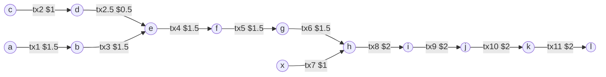

# Label propagation with a jump table

[← The Spark sketch](../README.md) · [Documentation](../../docs/README.md)

On Spark, label propagation takes one round per hop, and each round runs several distributed joins. The jump table composes every chain of single-slice hops once and stores the result, so propagation takes one round per head instead: per payment where funds start, mix, or take a new route. The table records positions, not labels, so a reclustering updates it in one join. [`jumps.py`](../jobs/lifo_spark/jumps.py) implements it, and [`check_jumps.py`](../jobs/check_jumps.py) checks it against the reference engine. It belongs to the Spark sketch: neither engine uses it, and no job runs a reclustering yet (see [what the sketch leaves out](../README.md#not-in-this-sketch)).

## Why rounds are the cost

Label propagation runs in time order. Each payment's label, which marks its money as stolen or clean, is made of slices of earlier payments' labels (the [labels-from-pieces lemma](../../docs/proofs.md#data-structures)). The engines propagate with a heap on one machine, where a long path costs little. On Spark, every round of [`propagate`](../jobs/lifo_spark/build.py#L108) runs several joins, so a change that travels 10 hops takes 10 rounds, and the number of rounds grows linearly with the longest path a change travels.

Most hops pass on a single slice of one earlier payment, and a slice of a slice is still a slice, so those hops form chains. Forks need no special handling: each branch of a fork is still one slice of the same block, so it stays in its chain. Composing each chain once and storing the result lets a change cross the whole chain in one step.

## Terms

- A **piece** (*s*, *o*, ℓ) is units [*o*, *o* + ℓ) of inflow *s*'s block, and a payment's **route** is its list of pieces, bottom first ([routes and labels](../../docs/02-routes-and-labels.md)).
- A **label** lists a payment's units bottom to top as runs of stolen (S) and clean (C) money, such as S1 C0.5: $1 stolen, then $0.5 clean. The code allows several stolen labels; two keep the example short.
- A **seed** is a payment whose route changed in a reclustering ([the update](../../docs/03-the-update.md)).
- A **pass-through** payment's route is a single piece.
- A **head** is a payment that is not a pass-through: a deposit, a payment that mixes funds from several inflows, or a seed. A pass-through's head is the nearest head upstream of it.

## The table

The jump table has one row per pass-through payment:

```
jumps(t, head, offset, length)    t carries units [offset, offset + length) of head's block
```

Like routes, the table records positions only, not labels, so it depends only on the ledger and the clustering.

**Building it.** Compose slices: if *t* = *s*[*o*, *o* + ℓ) and *s* = *h*[*o*ₛ, *o*ₛ + *a*ₛ), then *t* = *h*[*o*ₛ + *o*, *o*ₛ + *o* + ℓ). One pass in time order does this, or about log₂(longest chain) rounds of pointer jumping on Spark ([`build_jumps`](../jobs/lifo_spark/jumps.py#L22)): every pass-through starts out pointing at its input, and each round composes every pointer with its target's, until every pointer lands on a head. Resolving the heads' own routes the same way ([`resolve`](../jobs/lifo_spark/jumps.py#L41)) gives the **head pieces**, each pointing at a head.

**Labels in a batch build.** [`build`](../jobs/lifo_spark/jumps.py#L86) propagates over heads only, starting from the deposits: each round recomputes, from their head pieces, the heads that read a head whose label just changed. Then one join fills in every pass-through payment ([`fill_in`](../jobs/lifo_spark/jumps.py#L51)), since its label is the slice [offset, offset + length) of its head's. A single machine would keep an index from each head to the heads that read it. On Spark, a join of the head pieces with the changed heads finds them instead.

## After a reclustering

[`recluster`](../jobs/lifo_spark/jumps.py#L126) takes five steps.

1. **Find the seeds.** Re-sweep only the clusters whose member set changed, found by hashing each cluster's members, and compare their routes with the old ones. By [Theorem 4](../../docs/proofs.md#factorization), no other route can change.
2. **Update the jump table in one join.** Make each seed a head, and resolve its new pieces to heads. Re-point every row and every head piece that lies under a seed: it is later than the seed, and its range of the seed's old head falls inside the seed's old range. Subtract the seed's old offset, and send an entry under two seeds to the later one. Only a seed that was a pass-through, and that some payment reads, can have entries under it. A seed that was already a head keeps its entries, since they already point at it. An internal transfer has no readers, and [skipping it matters](#why-a-seed-needs-a-reader).
3. **Propagate over heads only,** in rounds that start from the seeds. Recompute each head's label from its head pieces. If the label changed, recompute the heads that read it. If it did not change, stop there.
4. **Fill in** the pass-through payments whose head's label changed, in one join: label(*t*) is the slice [offset, offset + length) of label(head).
5. **Update holdings** from the new labels ([`flows_and_holdings`](../jobs/lifo_spark/build.py#L139), by Theorem 5).

### Why the table needs no rounds

Labels and the jump table behave differently. Labels describe content: they mark the money as stolen or clean. A label change ripples downstream, so it takes rounds over heads, and it stops where a label comes out the same.

The jump table describes positions only. A reclustering changes routes only at its seeds, and every route downstream stays the same. An entry under a seed therefore keeps its position relative to that seed and only needs re-anchoring. Step 2's range rule finds all of those entries directly, however far downstream they lie, so it takes one join, with no rounds and no stopping rule.

## A worked example

Twelve payments in time order, with amounts in dollars (the job takes integers, so to run it, count half dollars). a's funds are stolen, and c's and x's are clean. Every wallet starts as its own cluster.



| Payment | From | To | Amount |
| --- | --- | --- | --- |
| tx1 | a | b | $1.5 |
| tx2 | c | d | $1 |
| tx2.5 | d | e | $0.5 |
| tx3 | b | e | $1.5 |
| tx4 | e | f | $1.5 |
| tx5 | f | g | $1.5 |
| tx6 | g | h | $1.5 |
| tx7 | x | h | $1 |
| tx8 | h | i | $2 |
| tx9 | i | j | $2 |
| tx10 | j | k | $2 |
| tx11 | k | l | $2 |

**Before.** The deposits tx1, tx2, and tx7 are heads, and so is tx8, which mixes g's and x's funds: its route takes the top $1 of tx6 and all of tx7. Every other payment is a pass-through, and the table resolves each chain to its head:

| Rows | Meaning |
| --- | --- |
| tx3, tx4, tx5, tx6 → (tx1, 0, 1.5) | all of tx1 |
| tx2.5 → (tx2, 0.5, 0.5) | the top half of tx2 |
| tx9, tx10, tx11 → (tx8, 0, 2) | all of tx8 |

tx8's piece of tx6 resolves through tx6's row, so its head pieces are tx1[0.5, 1.5) and tx7[0, 1). With a's funds stolen, tx3 to tx6 are S1.5, and tx8 to tx11 are S1 C1.

**The merge.** Merge d into b's cluster. Re-sweeping {b, d}, tx1 and tx2 arrive, tx2.5 takes the top $0.5 of tx2 as before, and tx3 now takes the remaining $0.5 of tx2 and the top $1 of tx1. tx3 is the only seed.

**Step 2.** tx3 becomes a head with head pieces tx1[0.5, 1.5) and tx2[0, 0.5). It was a pass-through with row (tx1, 0, 1.5), and tx4 reads it, so the entries under it are those that point at tx1, come after tx3, and lie inside tx1[0, 1.5): the rows of tx4, tx5, and tx6, and tx8's head piece tx1[0.5, 1.5). They now point at tx3, with tx3's old offset, 0, subtracted:

| Rows | Meaning |
| --- | --- |
| tx4, tx5, tx6 → (tx3, 0, 1.5) | all of tx3 |
| tx2.5 → (tx2, 0.5, 0.5) | unchanged |
| tx9, tx10, tx11 → (tx8, 0, 2) | unchanged |

tx8's head pieces become tx3[0.5, 1.5) and tx7[0, 1).

**Step 3.** Two head rounds. tx3 becomes S1 C0.5 (it was S1.5). tx8 reads it and becomes S0.5 C1.5 (it was S1 C1). No head reads tx8, so the rounds stop.

**Step 4.** Each of the six other changed labels is a slice of tx3's or tx8's, which are already final, so one join fills them in. The labels table stores stolen runs (t, start, length, label), one row per run, and the join clips each run of the head to the row's slice:

```sql
SELECT j.t,
       GREATEST(j.offset, l.start) - j.offset AS start,
       LEAST(j.offset + j.length, l.start + l.length) - GREATEST(j.offset, l.start) AS length,
       l.label
FROM jumps j JOIN labels l ON l.t = j.head
WHERE j.head IN ('tx3', 'tx8')          -- the heads whose label changed
  AND GREATEST(j.offset, l.start) < LEAST(j.offset + j.length, l.start + l.length)
```

tx4, tx5, and tx6 become S1 C0.5, and tx9, tx10, and tx11 become S0.5 C1.5. Only two labels changed, so Spark can broadcast them to every machine instead of shuffling the jump table.

**Step 5.** Stolen holdings move from $1 at l and $0.5 at h to $0.5 each at l, h, and {b, d}.

Two head rounds and two joins (re-point and fill-in) replace 8 rounds over every payment, one for each of tx3, tx4, tx5, tx6, tx8, tx9, tx10, and tx11. `jumps.py` produces exactly these rows, labels, and holdings for this ledger, and they match the reference engine.

## Why a seed needs a reader

The range rule in step 2 rests on each unit moving on along one path: a payment removes the units it carries, so no later payment carries them on from the same block. An internal transfer is the exception. It reads units without removing them and creates no block, so a later payment can carry the same units, and nothing ever reads the internal transfer.

A small ledger shows what goes wrong without the condition. A stolen $1 deposit h reaches u, and y receives a clean $0.5 deposit g just after. Then u pays v $1 inside the cluster {u, v} (an internal transfer r), y pays q $0.5, v pays w $1 (o), and w pays z $1 (e). Under the old clustering, r and o each carry all of h, and e carries all of o, so the rows of r, o, and e are all (h, 0, 1). Merging y into {u, v} puts g on top of h when r runs, so r's route changes and r is the only seed. y's payment to q then removes g, and o still carries all of h. The rows of o and e point at h, come after r, and lie inside r's old range, so the range rule alone would re-point them to r and give them r's new label, S0.5 C0.5. Their labels are still S1, and skipping seeds without readers keeps them right: `jumps.py` gives S1, and with the condition removed it gives S0.5 C0.5.

## Cost

The number of rounds equals the number of heads on the longest changed path, not the number of hops. A chain of pass-through payments collapses to a single jump however long it runs, as when funds hop from wallet to wallet with small amounts paid out along the way. This usually means far fewer rounds, though the count is still linear if every hop mixes funds. In the local checks, a batch build took 11 rounds over heads against 20 over all payments on a ledger of 3,391 transfers, and 11 against 25 on 7,706 transfers.

Seeds stay heads, so after many reclusterings the table compresses less, and the number of rounds creeps up. Correctness holds, and an occasional rebuild restores the compression.

## Why it is exact

The argument builds on [the proofs appendix](../../docs/proofs.md): [Theorem 4](../../docs/proofs.md#factorization) (routing locality), [Theorem 6](../../docs/proofs.md#data-structures) (the block stack: inputs precede their readers, and a pop removes exactly the units carried), the labels-from-pieces lemma, and Lemma A in the proof of [Theorem 8](../../docs/proofs.md#the-algorithm). As there, the ledger is valid, cut(*L*, *o*, ℓ) keeps the runs of label *L* that overlap units *o* to *o* + ℓ − 1, clipped to them, and ⊕ joins two run sequences.

**Lemma 1 (slices).** If the jump table has the row (*t*, *h*, *O*, ℓ), then

```math
L_t = \mathrm{cut}(L_h, O, \ell)
```

and if a head *t* has head pieces (*h*₁, *O*₁, ℓ₁), …, (*h*ₖ, *O*ₖ, ℓₖ), then

```math
L_t = \mathrm{cut}(L_{h_1}, O_1, \ell_1) \oplus \cdots \oplus \mathrm{cut}(L_{h_k}, O_k, \ell_k)
```

*Proof.* A pass-through *t* with piece (*s*, *o*, ℓ) has *L*ₜ = cut(*L*ₛ, *o*, ℓ), by the labels-from-pieces lemma with one piece. If *s* is itself a pass-through with row (*s*, *h*, *P*, *b*), then *L*ₛ = cut(*L*ₕ, *P*, *b*) by induction along the chain, which ends because inputs precede their readers. A slice of a slice is a slice, cut(cut(*L*ₕ, *P*, *b*), *o*, ℓ) = cut(*L*ₕ, *P* + *o*, ℓ), so *L*ₜ is the slice its row names. Pointer jumping adds the same offsets, and composition is associative, so the grouping of the rounds does not matter. Applying this to each piece of a head gives the second form. ∎

**Lemma 2 (the range rule).** Let σ be a pass-through that some payment reads, with row (σ, *h*, *P*, *b*), and let *e* be a row or head piece of payment *t* that points at *h* with range [*O*, *O* + ℓ). Then σ is a link of *e*'s chain if and only if *t* is later than σ and [*O*, *O* + ℓ) ⊆ [*P*, *P* + *b*).

*Proof.* *Only if.* Along a chain, each link carries a sub-range of the next link's range, in the coordinates of *h*'s block, and inputs precede their readers.

*If.* A payment that some payment reads has a block, so it is an external transfer, an outflow of its cluster. This holds for σ and for every inner link of a chain. Fix a position *p* in [*O*, *O* + ℓ). The unit at *p* in *h*'s block stays on the stack of *h*'s cluster until an outflow removes it, and an outflow removes exactly the units it carries (Theorem 6), so at most one outflow carries that unit on. The same holds for that outflow's own unit at the matching position, and so on: the outflows that carry *p* onward form one sequence *f*₁ < *f*₂ < ⋯, each reading the block of the one before. Any outflow that is a link of a chain covering *p* reads *p*'s unit from the previous link's block and removes it, so it is in this sequence. Hence σ = *f*ᵢ for some *i*, and the inner links of *e*'s chain are *f*₁, …, *f*ⱼ for some *j*, with *t* reading *p*'s unit from the block of *f*ⱼ (of *h*, if *j* = 0). If *t* is an outflow, then *t* = *f*ⱼ₊₁, and *t* > σ gives *i* ≤ *j*. If *t* is an internal transfer, it reads the unit while the unit is still on the stack, before *f*ⱼ₊₁ removes it, so *f*ᵢ < *t* < *f*ⱼ₊₁, and again *i* ≤ *j*. Either way σ is a link of *e*'s chain. ∎

The condition that some payment reads σ is needed: an internal transfer is in no such sequence, and the example above passes the range test without lying on the chain.

**Step 2 is exact.** The seeds are exactly the payments whose routes changed, and by Theorem 4 only the new clusters' routes can change. A payment that is not a seed keeps its route, so it stays a pass-through or a head. Take a row or head piece *e* of a payment *t* that is not a seed. The links of its chain keep their routes up to the first seed on the chain, if any. If no seed is a link, *e* is still right. Otherwise *e*'s new head is the seed nearest *t* on the chain, which is the latest one, and its new offset is its old offset less that seed's, because the links in between are unchanged. Every seed that is a link was a pass-through that some payment reads, so by Lemma 2 the seeds the rule matches for *e* are exactly the seeds that are links of its chain, and the rule takes the latest. A seed that was already a head ends every chain that reaches it, so its entries already point at it. Last, each seed's new pieces point at earlier payments whose rows are now right, so resolving them gives the seed's head pieces.

**Steps 3 and 4 are exact.** Call a payment dirty if its label changes. Let *t* be a pass-through that is not a seed, with new row (*t*, *h*′, *O*′, ℓ). The links between *t* and *h*′ are unchanged, and *h*′ was a link of *t*'s old chain or its old head, so by Lemma 1 the old and new labels of *t* are the same slice of the old and new labels of *h*′: *t* is dirty only if *h*′ is. A head that is not a seed keeps its route, and by the labels-from-pieces lemma its label is a function of its inputs' labels, where each input is a head or a pass-through that is dirty only if its new head is. So, as in Lemma A, a dirty head is a seed or reads a dirty head through its new head pieces. Rounds that start at the seeds and recompute the readers of every head that changed therefore reach every dirty head, and since inputs precede their readers, each head's last recomputation sees its inputs' final labels. The equality cutoff skips only the readers of heads whose label did not change, and those readers cannot become dirty through them. Step 4 then recomputes every pass-through that can be dirty, by Lemma 1, and step 5 is Theorem 5. ∎

## How it is checked

[`check_jumps.py`](../jobs/check_jumps.py) builds the table on a generated ledger, applies random merges and splits one at a time, and after each one requires every label and holding to equal `lifo.fresh_trace` and the kept pieces to equal a full re-sweep. Across seeds and two ledger sizes, 62 random merges and splits on ledgers of 3,187 to 7,828 transfers all matched. [The Spark README](../README.md#the-jump-table) has a run.
